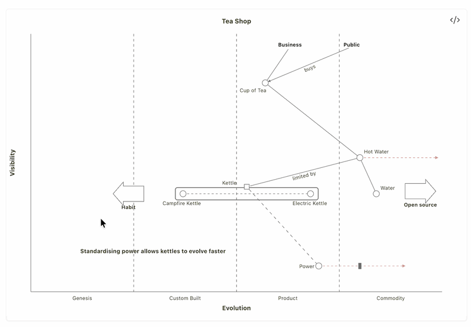

# Mermaid Direct Edit

Edit Mermaid diagrams in Obsidian by dragging the drawing itself. Every change is written back into the ` ```mermaid ` code block as plain text, so the code stays the single source of truth and keeps working everywhere else Mermaid runs.

The first version covers **Wardley maps** (`wardley-beta`). More diagram types are planned, and contributions are welcome (see [Contributing](#contributing)).



## What it does

**1. Renders with a current Mermaid.** Obsidian bundles its own, older Mermaid (11.13 in Obsidian 1.14). This plugin draws every native ` ```mermaid ` block with a pinned Mermaid **12.1.0**, so newer diagram types such as `wardley-beta` work in reading view, live preview and PDF export. It keeps the classic look (`look: classic`, `layout: dagre`, `theme: default`). Disable the plugin to return to Obsidian's own Mermaid.

**2. Lets you edit Wardley maps directly.** In a rendered `wardley-beta` map you can:

| Do this | To get this in the code |
|---|---|
| Drag a component, anchor, note, accelerator or deaccelerator | its `[visibility, evolution]` changes |
| Drag a component's label | `label [dx, dy]` |
| Drag the tip of a red evolve arrow | `evolve Name 0.62` |
| Drag the inertia bar along the evolve arrow | a plugin comment `%% mp-inertia Name 0.66` (see below) |
| Drag a pipeline box | the pipeline and its components move together |
| Grab a link's end and drop it on another element | `A -> B` becomes `A -> C` |
| Click next to an element (a "+" appears), drag to another one | a new link `A -> B` |
| Click the middle of a link | a dialog: label, direction (line, dashed, arrow either way or both), delete |
| Click a red evolve arrow's shaft (long press on touch) | the evolve arrow is deleted |
| Double-click (double-tap) an element | a dialog: rename everywhere, toggle inertia, delete |
| Hover a bottom corner of the map | a legend to add a component, anchor, note, evolve arrow, inertia, accelerator, deaccelerator or pipeline |

Every edit is checked with Mermaid's own parser before it is written; an edit that would break the diagram is refused with a notice. In live preview an edit can be undone with Cmd/Ctrl+Z. It works with mouse and touch, on desktop and mobile.

**3. Wardley maps as data, for scripts and agents.** Two [Obsidian CLI](https://help.obsidian.md/cli) commands (desktop, Obsidian 1.12+) read a map as JSON and bring a map in line with a JSON model, by the same in-place edits: everything the model does not mention stays exactly as written.

```bash
obsidian mermaid-direct-edit:wardley-read  path="Maps/Tea Shop.md"
obsidian mermaid-direct-edit:wardley-apply path="Maps/Tea Shop.md" model='{"elements":[…]}' dry-run
```

`wardley-read` lists elements, pipelines, links, evolve arrows, notes, accelerators and annotations with their line numbers, positions normalised to 0-1, plus the problems Mermaid would not tell you (a value outside 0-1, a link to an undeclared element). `wardley-apply` reports every change and every conflict, and removes nothing unless asked. The JSON shape is versioned: [docs/wardley-model.md](docs/wardley-model.md).

## Example

````markdown
```mermaid
wardley-beta
title Tea Shop
anchor Business [0.95, 0.63]
component Cup of Tea [0.79, 0.61]
component Hot Water [0.52, 0.80]
component Kettle [0.43, 0.35] (inertia)
Business -> Cup of Tea
Cup of Tea -> Hot Water
Hot Water -> Kettle
evolve Kettle 0.62
note "Standardising power allows kettles to evolve faster" [0.30, 0.49]
```
````

## Installation

The plugin is not yet in Obsidian's community plugin list. Until then:

- **With [BRAT](https://github.com/TfTHacker/obsidian42-brat):** add the beta plugin `CurlyPeter/obsidian-mermaid-direct-edit`.
- **By hand:** download `main.js`, `manifest.json` and `styles.css` from the [latest release](https://github.com/CurlyPeter/obsidian-mermaid-direct-edit/releases/latest) into `<your vault>/.obsidian/plugins/mermaid-direct-edit/`, then enable **Mermaid Direct Edit** under Settings → Community plugins.

Requires Obsidian with Mermaid enabled for the vault. `main.js` is about 5 MB because it contains Mermaid; it is evaluated only when the first diagram is drawn.

## Settings

- **Edit Wardley maps** (on by default, per device): turn it off to keep the current rendering without any editing.

## Good to know

- **Inertia position is a plugin extension.** The Wardley grammar knows inertia only as a flag; Mermaid draws the bar at a fixed spot. A dragged bar is stored as a Mermaid comment `%% mp-inertia <name> <evolution>`. Other renderers ignore the comment and show the default position.
- **Maps that render but are not editable:** maps written on the 0-100 scale (the editor writes 0-1), maps inside a callout, list or quote, maps embedded from another note (open that note), maps with a multi-line `accDescr { … }` block, and very large maps (a line over 1000 characters or more than 64 KB). Edit those in the code.
- **Security:** Mermaid runs with `securityLevel: strict`, as in Obsidian. The plugin makes no network requests. Edits only ever change the one code block they belong to.

## Contributing

Ideas, bug reports and pull requests are welcome, including small ones. The goal is direct editing for more Mermaid diagram types. See [CONTRIBUTING.md](CONTRIBUTING.md) for a five-step setup and how to open a pull request.

## License

[MIT](LICENSE). The bundled [Mermaid](https://github.com/mermaid-js/mermaid) is MIT licensed as well; its license notices are kept in `main.js`.
